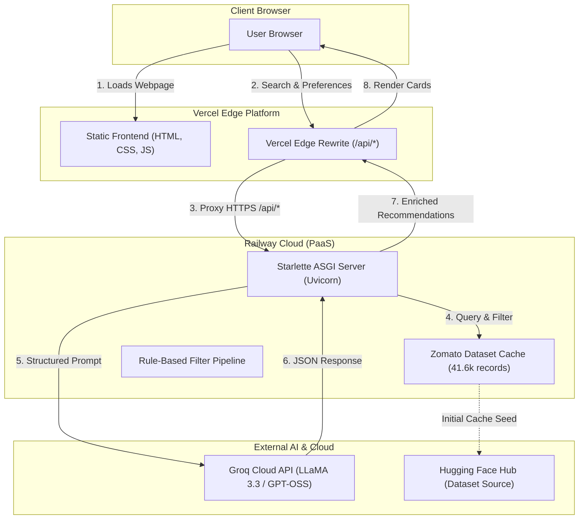

# 🚀 Deployment Plan: Zomato AI Dining Discovery
### Backend on Railway &bull; Frontend on Vercel

---

## 📌 Architecture Overview

This project follows a decoupled, cloud-native architecture:
- **Frontend (Vercel)**: High-speed edge CDN delivering static HTML5, Tailwind CSS, and vanilla JS. Routes `/api/*` calls securely via edge rewrites or direct HTTPS.
- **Backend (Railway)**: Containerized Python ASGI server (Starlette + Uvicorn) managing rule-based filtering on the 41,600+ restaurant dataset, LLM prompt generation, and Groq Cloud inference.
- **AI Inference (Groq Cloud)**: Ultra-fast LLaMA 3.3 / GPT-OSS inference engine.



---

## 📋 Required Pre-Deployment Configuration Files

Before deploying, the repository needs three lightweight configuration files:

### 1. `Procfile` (for Railway)
Tells Railway how to launch the Starlette ASGI web server:
```procfile
web: uvicorn src.server:app --host 0.0.0.0 --port $PORT
```

### 2. `railway.json` (Optional, for Nixpacks build configuration)
```json
{
  "$schema": "https://railway.app/railway.schema.json",
  "build": {
    "builder": "NIXPACKS"
  },
  "deploy": {
    "startCommand": "uvicorn src.server:app --host 0.0.0.0 --port $PORT",
    "restartPolicyType": "ON_FAILURE",
    "restartPolicyMaxRetries": 3
  }
}
```

### 3. `vercel.json` (for Vercel API Rewrites)
Allows the Vercel frontend to proxy API requests to Railway seamlessly without CORS or mixed-content issues:
```json
{
  "rewrites": [
    {
      "source": "/api/:path*",
      "destination": "https://<YOUR-RAILWAY-DOMAIN>.up.railway.app/api/:path*"
    }
  ]
}
```

---

## 🛠️ Phase 1: Deploy Backend to Railway

### Step 1.1: Push Repository to GitHub
Ensure all latest code, including `src/server.py` and `requirements.txt`, is pushed to your GitHub repository:
```bash
git add .
git commit -m "feat: add starlette production server and deployment configurations"
git push origin main
```

### Step 1.2: Create Project on Railway
1. Log in to [Railway.app](https://railway.app/).
2. Click **"New Project"** &rarr; Select **"Deploy from GitHub repo"**.
3. Choose your repository: `Milestone-Zomato`.
4. Railway will automatically detect the Python project via `requirements.txt`.

### Step 1.3: Configure Environment Variables
In the Railway project dashboard, go to the **Variables** tab and add the following keys:

| Variable Name | Value / Description | Required? |
| :--- | :--- | :--- |
| `LLM_PROVIDER` | `groq` | Yes |
| `GROQ_API_KEY` | `gsk_...` *(your Groq API Key from console.groq.com)* | Yes |
| `GROQ_MODEL` | `openai/gpt-oss-120b` *(or `llama-3.3-70b-versatile`)* | Yes |
| `TOP_N_CANDIDATES`| `15` | Yes |
| `PORT` | Auto-provided by Railway (defaults to container port) | Auto |

### Step 1.4: Generate Public Domain
1. In Railway, click on your service &rarr; **Settings** &rarr; **Networking**.
2. Click **"Generate Domain"** (e.g., `milestone-zomato-production.up.railway.app`).
3. Copy this URL.

### Step 1.5: Verify Backend Health
Test that the backend is live by opening:
```bash
curl https://<YOUR-RAILWAY-DOMAIN>.up.railway.app/api/health
```
**Expected Response:**
```json
{
  "status": "healthy",
  "llm_provider": "groq",
  "dataset_nodes": 41654,
  "city": "Bangalore"
}
```

---

## 🌐 Phase 2: Deploy Frontend to Vercel

### Step 2.1: Configure Vercel API Proxy
Update `vercel.json` with your real Railway domain:
```json
{
  "rewrites": [
    {
      "source": "/api/:path*",
      "destination": "https://<YOUR-RAILWAY-DOMAIN>.up.railway.app/api/:path*"
    }
  ]
}
```

### Step 2.2: Deploy on Vercel Dashboard
1. Log in to [Vercel.com](https://vercel.com/).
2. Click **"Add New..."** &rarr; **"Project"**.
3. Import your GitHub repository (`Milestone-Zomato`).
4. In the **Configure Project** screen:
   - **Framework Preset**: `Other`
   - **Root Directory**: Click `Edit` and select `frontend` (or leave as `./` if using `vercel.json` at root).
   - **Build & Development Settings**: Leave default (no build command needed for pure HTML/JS).
5. Click **"Deploy"**.

### Step 2.3: Assign Domain & Test
Vercel will output a live URL (e.g., `https://milestone-zomato.vercel.app`).
Open the URL in your browser to verify:
- Header and neighborhood selector load.
- Presets populate dynamically from `/api/presets`.
- Clicking **"Find Restaurants"** triggers the recommendation pipeline and returns curated cards.

---

## 🧪 Phase 3: Verification & Sanity Checks

| Test Case | How to Test | Expected Result |
| :--- | :--- | :--- |
| **Health Check** | `GET /api/health` | HTTP 200, status `healthy`, 41k records |
| **Location List** | `GET /api/locations` | HTTP 200, array of 92 Bangalore areas |
| **Curated Presets** | Click `🍕 Casual Italian` on Vercel UI | Form prefills instantly and fetches recommendations |
| **Custom Filter** | Select *Koramangala*, *North Indian*, Budget *Medium* | Returns ranked cards with ratings and dishes |
| **Table Reservation** | Click *"Reserve Table"* &rarr; Submit modal | Instant reservation confirmation with ID |
| **CORS / Proxy** | Inspect browser network tab | All `/api/*` calls return HTTP 200 without CORS errors |

---

## 🔒 Security & Best Practices

1. **Keep `.env` Secrets Out of Git**:
   - `GROQ_API_KEY` is configured exclusively in Railway's environment dashboard.
   - Never commit `.env` or production API tokens into GitHub.
2. **CORS Hardening (Optional for Production)**:
   - Once your Vercel domain is live (e.g., `https://milestone-zomato.vercel.app`), update `src/server.py` to only allow your specific Vercel origin for enhanced API protection.
3. **Dataset Caching Strategy**:
   - The cleaned dataset (`data/processed/zomato_clean.parquet`) is ~446 KB. Committing this preprocessed file directly ensures Railway restarts take under 1 second without needing to download raw data on boot.

---

## 📦 Summary of Commands

```bash
# Test backend locally before push
python -m pytest tests/test_server.py -v

# Push to GitHub
git add .
git commit -m "chore: setup deployment configuration for Railway and Vercel"
git push origin main
```
